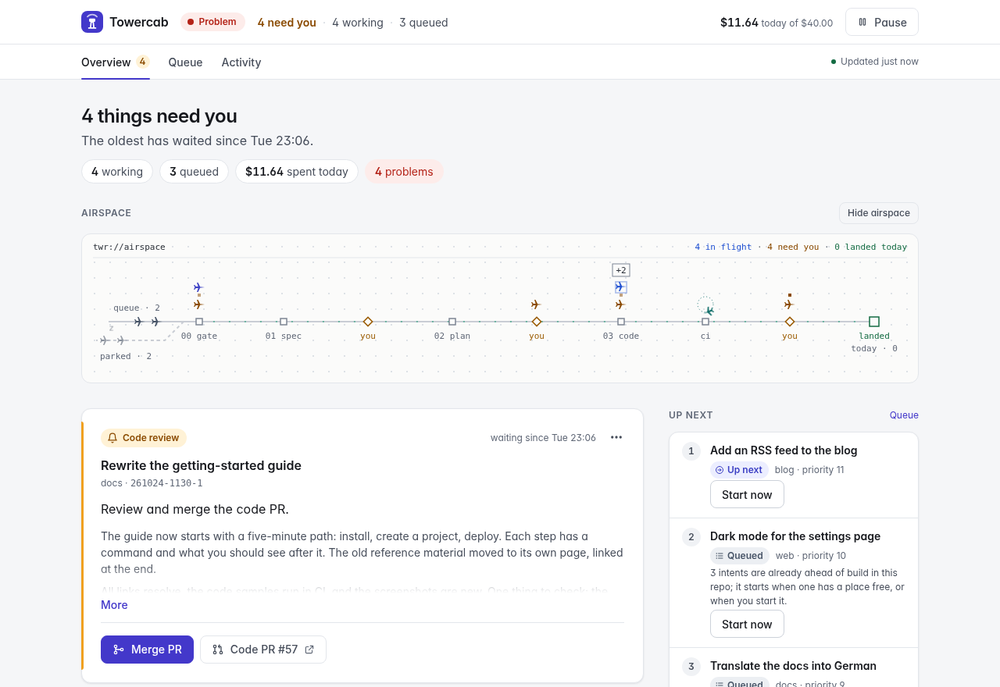
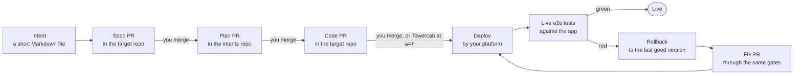
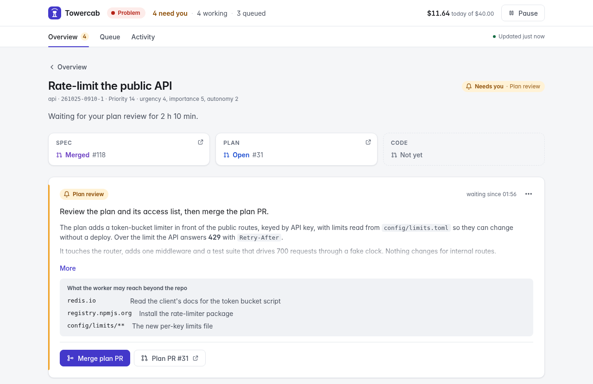
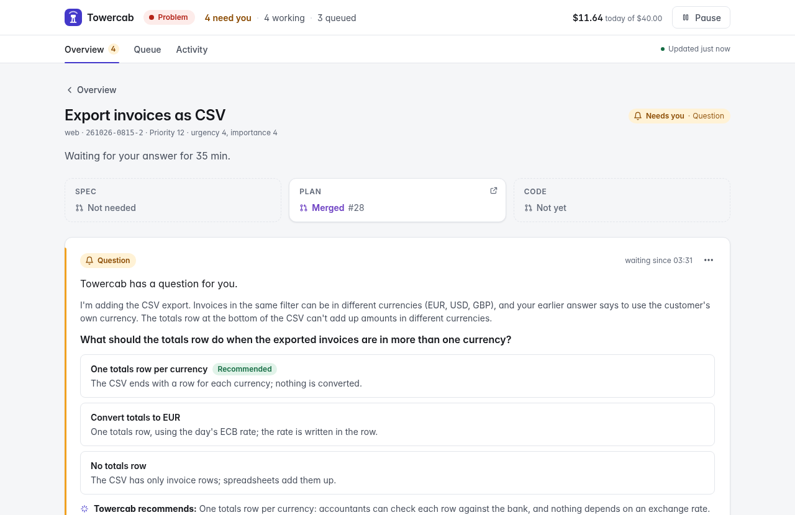

<p align="center">
  
</p>

<h1 align="center">Towercab</h1>

<p align="center">
  <strong>From intent to production.</strong><br>
  Spec, plan, code, deploy, live test and rollback, orchestrated around Claude Code on your own
  machine.<br>
  <sub>Inspired by Anthropic's AI-Native SDLC Playbook. Not affiliated with or endorsed by Anthropic.</sub>
</p>

<p align="center">
  <a href="https://github.com/MajidBabaeifar/towercab/actions/workflows/ci.yml"></a>
  <a href="LICENSE"></a>
  
  
  
</p>

<p align="center">
  <a href="#how-it-works">How it works</a> ·
  <a href="#quickstart">Quickstart</a> ·
  <a href="#safety">Safety</a> ·
  <a href="#docs">Docs</a>
</p>

<picture>
  <source media="(prefers-color-scheme: dark)" srcset="docs/assets/overview-dark.png">
  
</picture>

## What it is

Towercab is an orchestrator for Claude Code that runs on your own machine. You describe a change as
an *intent*: a short Markdown file saying what the problem is, what outcome you want, and how urgent
and important it is. Towercab picks the most important one, has Claude Code turn it into a spec, a
plan and the code, checks the result in code (sandboxed checks, a red→green test proof, CI and a
review), and opens pull requests you review on GitHub. After the merge it follows the change to
production: it waits until your platform has deployed it, runs end-to-end tests against the live app,
and when they fail, rolls back to the last good version and fixes forward. How much it does without
you depends on the autonomy level you give each intent.

It is inspired by Anthropic's AI-Native SDLC Playbook and follows its structure.
Towercab is not affiliated with or endorsed by Anthropic.

The website is [towercab.com](https://towercab.com).

## How it works

Every intent becomes three pull requests, and merging each one is your approval
([specs/pipeline.md](specs/pipeline.md)). In a repo that opts in, the merge is followed to production
([specs/ship.md](specs/ship.md)):



1. **Spec PR** in the target repo: the requirements the change adds or alters, in plain sentences.
2. **Plan PR** in your intents repo: the approach and why, the steps, the risks, and a checklist of
   the access the worker expects to need (network domains, protected files). Untick what you refuse.
3. **Code PR** in the target repo: written test-first, checked locally and in CI, reviewed by a
   separate Claude session, with a description that says what it does, why, and what to check.

4. **Ship**, for a repo with a `live` block in its `TOWERCAB.md`: Towercab waits until your platform
   says the merge commit is live, then runs the repo's end-to-end suites against the live URL. Every
   change has to bring e2e tests for what it adds. When a suite fails twice, Towercab asks the
   platform for the last good version, runs the smoke suites against it, and has the worker fix the
   cause in a new PR that ships the same way. Two failed fixes and it reverts the change and hands the
   intent back to you. Your platform does the deploys; Towercab only asks it to deploy the last good
   version or a revert, as the [deploy contract](docs/deploy-contract.md) describes. Without a `live`
   block, merged means done.

You steer with ordinary GitHub actions. Merge to approve, close to drop, comment or request changes
to send it back with your notes, and reply to a question to answer it. `/retry` starts over. A local
web page shows what needs you, what is stuck, what is moving and what it costs
([specs/ui.md](specs/ui.md)), and Telegram tells you when something waits on you. With `[shadow] enabled` you can also talk to Towercab there: ask what is going on, think something through and have it act within limits you set ([specs/shadow.md](specs/shadow.md)).

<table>
  <tr>
    <td width="50%" valign="top">
      <picture>
        <source media="(prefers-color-scheme: dark)" srcset="docs/assets/intent-dark.png">
        
      </picture>
      <p><strong>Review a plan.</strong> Each intent's page shows its three PRs and what the worker
      wants to reach beyond the repo, so you know what you approve when you merge.</p>
    </td>
    <td width="50%" valign="top">
      <picture>
        <source media="(prefers-color-scheme: dark)" srcset="docs/assets/question-dark.png">
        
      </picture>
      <p><strong>Answer a question.</strong> When the worker is unsure, it asks with options and a
      recommendation, and goes on as soon as you reply here or on GitHub.</p>
    </td>
  </tr>
</table>

## Requirements

- Linux with systemd (`towercab up` installs a user service)
- Node.js 22.18 or newer
- `bwrap` (bubblewrap), the sandbox for checks and Claude Code runs
- `git`, and `gh` 2.46 or newer, logged in as you
- the Claude Code CLI (`claude`), logged in
- a GitHub App for Towercab, made from [ops/github-app.json](ops/github-app.json)

## Quickstart

1. Clone and install:

   ```bash
   git clone https://github.com/MajidBabaeifar/towercab.git && cd towercab && npm ci && npm run build:ui
   ```

2. Register the GitHub App from `ops/github-app.json`, install it on your intents repo and every
   repo Towercab should work in, and save its private key as `~/.config/towercab/app.pem` (mode 600).
3. Copy [config.example.toml](config.example.toml) to `~/.config/towercab/config.toml` and replace its
   placeholders (it lists every setting with a comment). The smallest working file is:

   ```toml
   [intents]
   remote = "https://github.com/<you>/intents.git"

   [github]
   app_id = 123456
   me = "<your login>"
   ```

4. Check the setup with `bin/towercab doctor`, add a repo with `bin/towercab repo add <you>/web` (it
   checks the App can reach it, takes its default branch and clones it), then start the service with
   `bin/towercab up` and open the page with `bin/towercab ui`. More repos can be added later from the
   page or with `repo add`, without a restart.
5. Add an intent with the page's "New intent" form, with `bin/towercab add "web: Log in with a magic link" u3 i4`
   (at a terminal both first check for intents that overlap yours), or with the `/intent` Claude Code skill
   (`./install.sh` links it).
6. Optional, for plans that need a secret in a SOPS file ([specs/ship.md](specs/ship.md), SHIP-33..36):
   install `sops` (a version with `set --value-stdin`) and make the age key readable by the Towercab
   service only (`SOPS_AGE_KEY_FILE` in its environment). Towercab never passes it to a worker.

## Safety

Towercab's work arrives as pull requests, and code decides whether they may merge: at a1–a3 you merge
every change yourself, and at a4–a5 Towercab merges only what passes every check and its risk rules allow.
Each run is sandboxed and can't touch your keys, other repos or protected files.

| Layer | What it does |
| --- | --- |
| **Sandbox** | Every check and every Claude Code run is sandboxed: no access to your keys, tokens or other repos, and a worker reaches only the network domains it is granted. |
| **Guard** | A hook stops the worker from writing protected files (CI, `CLAUDE.md`, `AGENTS.md`, `REVIEW.md`, `TOWERCAB.md`, and paths you list) unless its plan grants them, and from editing tests it already pushed during repairs. |
| **Gates** | Code, not a model, decides whether a PR may merge: green CI, an approving review, a test that fails without the change, and a risk level with a floor set in code. |
| **Ship** | In a repo that opts in, a change counts as done only once its e2e tests pass against the live app. A failure rolls back to the last good version and checks it with smoke tests; a rollback that fails freezes the repo until you look. |
| **Autonomy** | At a1–a3 you merge everything. At a4 Towercab merges the plan and the code itself when every check passes, the build stayed within the plan, and an independent risk check rates the change low. At a5 (only for intents you wrote; an intent without a level counts as a5) medium risk goes ahead too, and only high risk waits for you ([specs/autonomy.md](specs/autonomy.md)). |

## Status

Early, and built for one person: it runs on one machine, for one owner, and is used daily by its
author. Version 1 (Rust) is on branch `rust`.

Cost: Towercab itself is free; the Claude Code runs it starts use your own Claude subscription or API
key, and the web page shows what each intent cost.

## Docs

| Spec | What it covers |
| --- | --- |
| [specs/README.md](specs/README.md) | How the specs work |
| [specs/intents.md](specs/intents.md) | Intent files and the intents repo |
| [specs/priority.md](specs/priority.md) | Scores and order |
| [specs/autonomy.md](specs/autonomy.md) | Gates and access |
| [specs/loop.md](specs/loop.md) | The program |
| [specs/pipeline.md](specs/pipeline.md) | From intent to merged PR |
| [specs/ship.md](specs/ship.md) | After the merge: deploy, e2e, rollback |
| [specs/repo.md](specs/repo.md) | What Towercab reads from a target repo |
| [specs/ui.md](specs/ui.md) | The local web page |
| [specs/metrics.md](specs/metrics.md) | Cost and time |
| [specs/public.md](specs/public.md) | What this repo shows |
| [specs/gitlab.md](specs/gitlab.md) | Projects hosted on GitLab |
| [specs/jira.md](specs/jira.md) | Tickets from Jira as intents, linked back |
| [specs/shadow.md](specs/shadow.md) | The owner's shadow assistant on Telegram |
| [specs/telegram.md](specs/telegram.md) | Buttons, replies and commands in Telegram |
| [specs/users.md](specs/users.md) | Several people with roles |
| [specs/observer.md](specs/observer.md) | An agent that watches how Towercab runs and proposes improvements |
| [specs/fast.md](specs/fast.md) | The fast lane for urgent intents |

Want to help? Read [CONTRIBUTING.md](CONTRIBUTING.md); everyone taking part follows the
[code of conduct](CODE_OF_CONDUCT.md).

<p align="center"><sub>Copyright (c) 2026 The Towercab authors · <a href="LICENSE">AGPL-3.0-only</a> · <a href="SECURITY.md">Report a vulnerability</a></sub></p>
